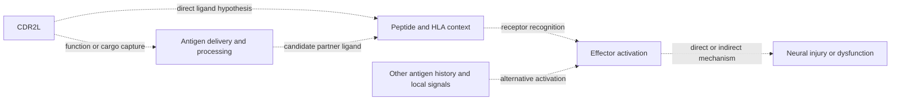

# Virtual Human pattern: testable interfaces for the anti-Yo frontier

**Subsequent work:** the [executed evidence-graph result](evidence-graph-result-2026-11-05.md)
records the authorized prototype and shared fork development. The assessment
below is preserved as the earlier design decision, before code execution.

**2026-11-05, America/Chicago. Status: candidate design; no implementation or
simulation executed.** Recommendation: **pattern only** from
[Rohan Arun's Virtual Human](https://github.com/rohanarun/virtual-human/tree/3d75e8e25d6f3fec08e1ccecd424532bccaa1b82).
This proposal applies its typed-graph idea to the
[antigen/presenter/effector frontier](anti-yo-frontier-2026-11-04.md) and
[round-2 research](https://github.com/Foundation-0/project-asma/pull/42).
It does not adopt the upstream package or propose an individual-patient model.

**CONJECTURE — intended contribution:** make unsupported transitions between
evidence types detectable and make competing mechanisms easier to distinguish.
A graph would earn its place by exposing an error or identifying a useful
discriminating observation that is harder to track in the current documents.
Its usefulness must be compared with those documents, not assumed from a diagram.

## What the source contributes

**KNOWN — static code assessment:** the inspected source implements typed
nodes/edges, schema checks, subgraphs and numerical engines. Its
[`Edge.model`](https://github.com/rohanarun/virtual-human/blob/3d75e8e25d6f3fec08e1ccecd424532bccaa1b82/vh/graph/core.py#L40)
is a string; no dispatcher resolving those names into model execution was
located. The
[binding bridge](https://github.com/rohanarun/virtual-human/blob/3d75e8e25d6f3fec08e1ccecd424532bccaa1b82/vh/bridge/occupancy.py#L10)
currently takes experimental Kd values. Binding-free-energy generation, cellular
pathways and end-to-end uncertainty remain
[roadmap work](https://github.com/rohanarun/virtual-human/blob/3d75e8e25d6f3fec08e1ccecd424532bccaa1b82/docs/roadmap.md#L44).
No implemented anti-Yo antigen-processing, receptor-recognition or injury model
was found in the inspected modules. Numerical accuracy on an implemented component
does not establish the missing biological relationships between components.

The source suggests a useful organizational pattern: make each relationship
explicit, inspect its assumptions, and check the interface independently.
For this project, that begins with evidence and measurement meaning.

### A concrete reason to type more than units

**KNOWN — source-code finding, not a new simulation:** the upstream graph
[copies](https://github.com/rohanarun/virtual-human/blob/3d75e8e25d6f3fec08e1ccecd424532bccaa1b82/vh/graph/physiology_graph.py#L68)
hepatic blood clearance and renal plasma clearance into the same `cl` field.
Its [subgraph check](https://github.com/rohanarun/virtual-human/blob/3d75e8e25d6f3fec08e1ccecd424532bccaa1b82/scripts/validate_graph.py#L72)
sums them and compares with the same copied operands. The underlying PBPK model
instead [converts the hepatic term](https://github.com/rohanarun/virtual-human/blob/3d75e8e25d6f3fec08e1ccecd424532bccaa1b82/vh/body/pbpk.py#L56)
to a plasma reference before summing. Both values have dimensions L/h, but their
reference concentrations differ. The equality in the graph report is therefore
not independent physiological validation. This finding concerns the graph
report, not a demonstrated defect in the PBPK differential equations.

**Design consequence (CONJECTURE):** an Asma quantity or claim should carry its
measurement basis, compartment and biological role in addition to its units.
The analogous error is treating antibody binding as T-cell specificity, or
protein abundance as peptide–HLA display. A type check must preserve these
distinctions without claiming it can prove a biological relationship.

## Three explanations to keep separate

These are **CONJECTURES**, already motivated in the frontier review. More than
one may operate; the graph must not force a single explanation.

| Hypothesis | Proposed relationship | Observation needed to distinguish it |
| --- | --- | --- |
| Direct ligand | A CDR2L-derived peptide in an appropriate HLA context activates a defined receptor. | Unambiguous ligand/source assignment, receptor recognition and natural processing; antibody reactivity alone is insufficient. |
| Delivery or partner ligand | CDR2L contributes cellular function or capture of cargo whose recognized ligand comes from another protein. | Identify the actual ligand while separating cargo delivery, cell health and presentation from CDR2L abundance. Whole-protein knockout/rescue cannot isolate these roles. |
| Indirect injury | An activated effector damages a neural/support target without that target presenting the original activating ligand. | Separate upstream activation from target recognition and injury; measure target function and death independently. |

The following is a conceptual map, with dotted edges denoting proposed links:

Reachability in this diagram means a proposed connection exists. It does not
show a causal effect, a viable route, a probability or a rate. Feedback and
compartment-specific relationships may require cycles or multiple model forms;
ordinary graph traversal is not causal identification.

## Proposed evidence and model contract

For a first small implementation, use existing public source claims and
artificial negative examples. Do not import a patient archive or new study data.
Each claim/relationship would carry:

| Field | Required distinction |
| --- | --- |
| Entity and role | Stable protein identity; antibody target, source protein, presented ligand, receptor, presenter or readout |
| Measurement | Assay, measured quantity, units, normalization/reference basis, bound/unbound or total/surface status where relevant |
| Context | Species/model, specimen or compartment category, perturbation, timing and applicable population; no individual identifiers |
| Evidence | Primary source/version/locator; project claim label; observation, intervention, inference or proposal; contrary evidence and unresolved gaps |
| Model interface, if one exists | Inputs/outputs, equations or implementation version, parameter provenance, validity domain and explicit conversion assumptions |
| Validation | Numerical verification, empirical validation and applicability to this research question recorded separately |
| Uncertainty | Known range or distribution only when supported; otherwise unknown. Preserve dependence between parameters and shared cohorts. |

An unknown effect cannot default to zero or one. An unmeasured rate cannot be
filled with a plausible-looking number to make the graph executable. Evidence
from one cell line cannot silently acquire a human-neuron context. A named
model must resolve to a reviewed implementation with matching input/output
semantics before numerical execution is even considered.

The useful output would be a bounded statement such as: “This explanation
requires these two unverified relationships; this proposed comparison could
separate it from another explanation under these assumptions.” It would not be
an automatically inferred mechanism, treatment ranking or simulated patient
outcome. Experiment selection itself needs scientific judgment; graph structure
does not guarantee that the proposed measurement is feasible or informative.

## Prospective acceptance tests

All tests below are **proposed**, not completed results:

1. Reject addition of quantities with the same dimensions but incompatible
   blood/plasma or other reference bases unless a supported conversion is explicit.
2. Reject antibody-binding evidence as sufficient proof of a CD4 ligand.
3. Reject a protein-associated mass-spectrometry annotation as unique protein
   attribution when sequence ambiguity remains unresolved.
4. Keep knockout/rescue compatible with both direct-antigen and indirect-function
   explanations until a discriminating observation is supplied.
5. Reject organ connectivity as proof of barrier passage or immune-cell traffic.
6. Refuse a causal injury conclusion when only activation was measured; preserve
   negative and contradictory experiments rather than deleting them.
7. Have an independent reviewer check that at least one proposed observation
   distinguishes two currently compatible explanations, and compare that result
   with the existing evidence tables.

These tests can verify consistency of encoded rules. They cannot certify that
the rules exhaust the biology. Stop if the graph adds no useful error detection
or decision support for researchers, depends on invented kinetics, or disguises
an assumption as empirical evidence.

## Cost, alternatives and continuation

**Planning estimate, not measured:** 1–3 working days for one engineer plus
scientific review for approximately 20–30 existing public claims and a small
set of artificial fixtures. A local standard-library representation should be
sufficient; no GPU, cloud service or new physics engine is needed for that
scope. The continuing cost is maintaining evidence and context as sources change.
The current Markdown tables remain a legitimate lower-cost alternative.

If a later question requires actual molecular or pharmacokinetic simulation,
compare established tools for that task and validate the specific use.
[OSP qualification reports](https://www.open-systems-pharmacology.org/OSP-Qualification-Reports/)
are organized by use case; [SBML](https://sbml.org/documents/specifications/)
provides model-exchange standards while explicitly distinguishing syntax from
semantics. Neither substitutes for the missing antigen/receptor/injury evidence.
Adopting a whole-body simulator for anti-Yo would be a substantially broader
research program with no defensible delivery estimate from this assessment.

No upstream software, patient data, figures or model-input tables are copied into
this proposal. Virtual Human is credited as inspiration. Its root
[MIT notice](https://github.com/rohanarun/virtual-human/blob/3d75e8e25d6f3fec08e1ccecd424532bccaa1b82/LICENSE)
would need preservation if code were later adapted; dependency and source-input
rights would remain separate. This design changes neither Pilot 001 nor its
[execution gates](roadmap.md). A merged design accepts the proposal, not an
executed prototype or research-data clearance.

Prepared with OpenAI Codex and independent internal agent critique. No upstream
tests or models were run; internal review is not external scientific validation.
